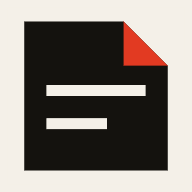
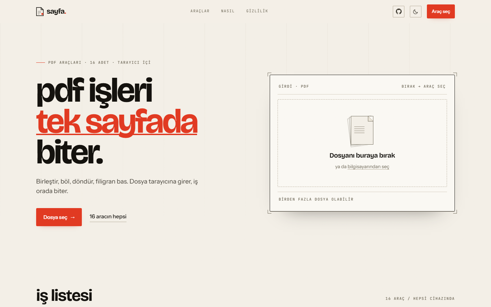
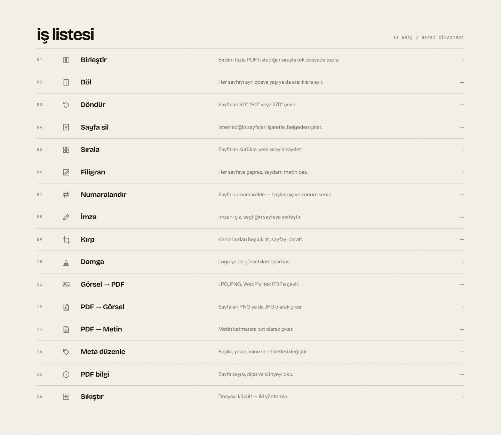
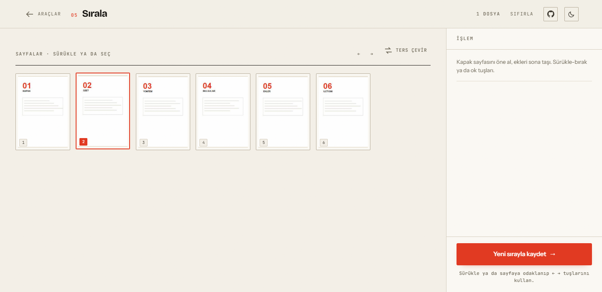
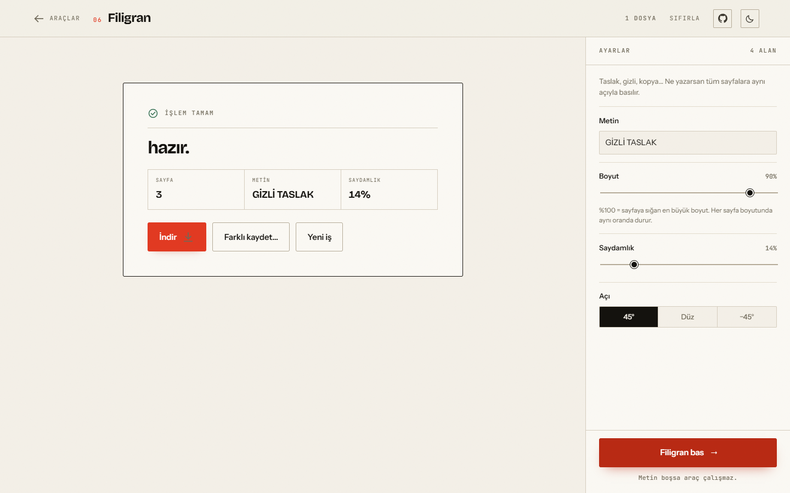
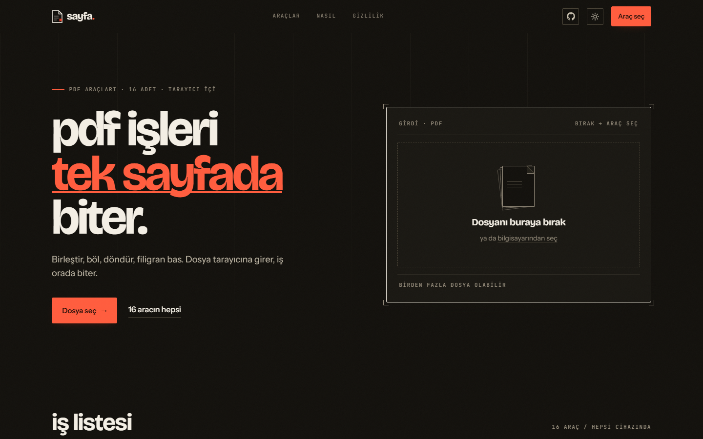

<p align="center">
  
</p>

<h1 align="center">sayfa</h1>

<p align="center">
  PDF işleri tek sayfada biter.<br>
  16 araç, tarayıcında çalışır, dosyan cihazından çıkmaz.
</p>

<p align="center">
  <a href="https://github.com/BerkeHazar/sayfa/actions/workflows/deploy.yml">
    
  </a>
  
  
  
</p>

<p align="center">
  <a href="https://berkehazar.github.io/sayfa/"><b>berkehazar.github.io/sayfa</b></a>
</p>



---

## Ne yapar

PDF ile yapılan sıkıcı işlerin hepsi: birleştir, böl, döndür, sayfa sil, sırala, filigran
bas, numaralandır, imzala, kırp, damgala, görselleştir, metne çevir, sıkıştır.

Dosya sunucuya yüklenmez. Tarayıcının belleğine girer, işlem orada biter, indirme orada
başlar. Hesap yok, kuyruk yok, yükleme beklemesi yok — tek sınır tarayıcının belleği.

## Araçlar

| # | Araç | Ne yapar |
|---|------|----------|
| 01 | Birleştir | Birden fazla PDF'i sırayla tek dosyada toplar |
| 02 | Böl | Aralıklara ayırır ya da her sayfayı ayrı dosya yapar (ZIP) |
| 03 | Döndür | Seçili sayfaları 90° / 180° / 270° çevirir |
| 04 | Sayfa sil | İşaretlenen sayfaları çıkarır |
| 05 | Sırala | Sayfaları sürükle-bırak ya da ok tuşlarıyla yeniden dizer |
| 06 | Filigran | Tüm sayfalara çapraz, saydam metin basar |
| 07 | Numaralandır | Konum, biçim ve başlangıç seçilebilir sayfa numarası |
| 08 | İmza | Çizilen imzayı seçilen sayfaya, seçilen köşeye gömer |
| 09 | Kırp | Kenarlardan mm cinsinden boşluk atar (CropBox) |
| 10 | Damga | PNG/JPG logo damgası basar |
| 11 | Görsel → PDF | JPG/PNG/WebP'yi A4 ya da kendi boyutunda PDF yapar |
| 12 | PDF → Görsel | Her sayfayı PNG/JPG olarak çıkarır |
| 13 | PDF → Metin | Metin katmanını `.txt` olarak çıkarır |
| 14 | Meta düzenle | Başlık, yazar, konu, etiket — ya da tamamen temizle |
| 15 | PDF bilgi | Sayfa sayısı, ölçü ve künyeyi okur (dosyayı değiştirmez) |
| 16 | Sıkıştır | İki yöntem: yapı (kayıpsız) ya da görüntü (küçük ama metinsiz) |

## Ekran görüntüleri

**İş listesi** — 16 aracın tamamı tek tabloda, kart ızgarası değil.



**Çalışma alanı** — sayfa kartları gerçek küçük görseller; pdf.js kendi worker'ında çiziyor.

| Sırala | Sonuç |
|:------:|:-----:|
|  |  |
| Sürükle ya da dokun → seç → `←` `→` | İndir, farklı kaydet ya da yeni iş |

<details>
<summary><b>Gece teması</b> — ters çevirme değil, negatif baskı</summary>

<br>



Kâğıt siyaha değil is mürekkebine dönüyor; sinyal kırmızı koyu zeminde kontrastını
yitirdiği için bir ton açılıyor. Tema `<head>` içindeki küçük bir betikle ilk boyamadan
**önce** uygulanıyor, yani karanlık modda beyaz flaş yok.

</details>

## Hangi iş, hangi motor

Tek kütüphaneye her şeyi yaptırmak yerine iş, doğru araca verildi.

| İş | Araç | Neden |
|----|------|-------|
| Yapısal düzenleme (birleştir, böl, döndür, sil, sırala) | **pdf-lib** | Sayfa ağacını okuyup yeniden yazar; render gerekmez, hızlı |
| Filigran, numara, imza, damga | **pdf-lib** + **@pdf-lib/fontkit** | Vektör metin ve görsel gömme; Türkçe için font gömer |
| Sayfa küçük görselleri, PDF→Görsel, PDF→Metin | **pdf.js 6** (Mozilla) | Gerçek rasterleştirme ve metin katmanı; pdf-lib bunların hiçbirini yapamaz |
| İmza çizimi | **Canvas 2D + Pointer Events** | Basınç duyarlı çizgi, `getCoalescedEvents()` ile akıcı iz |
| Kırpma | **pdf-lib CropBox** | Görünür alanı daraltır; içerik silinmez, geri alınabilir |
| Sıkıştırma (görüntü) | **pdf.js → JPEG → pdf-lib** | Sayfayı rasterleştirip yeniden paketler; bedeli metin katmanı |
| Çoklu çıktı | **JSZip** | Böl/çıkar sonuçlarını tek arşivde paketler |
| Kaydetme | **File System Access API** | Varsa doğrudan diske yazar, yoksa klasik indirme |

### Bütçe (gzip)

| Parça | gzip | Ne zaman iner |
|-------|------|----------------|
| İlk yükleme (JS + CSS) | ~18 KB | her zaman |
| Yazı tipleri (6 × woff2, variable) | ~190 KB | ilk boyama |
| pdf-lib + fontkit | ~508 KB | ilk araç açılışında |
| pdf.js | ~131 KB | sayfa çizilen ilk araçta |
| pdf.js worker | 2,2 MB (sıkıştırılmamış) | aynı anda, ayrı thread'de |
| JSZip | ~30 KB | çoklu çıktı gerektiğinde |

Açılış sayfası ağır motorların hiçbirini görmez: `catalog.ts` yalnızca başlık ve açıklama
taşır, motorlar `import()` ile araç açılınca iner.

## Hızlı başlangıç

```bash
git clone https://github.com/BerkeHazar/sayfa.git
cd sayfa
npm install
npm run dev
```

`http://localhost:5173` — canlı yeniden yükleme.

| Komut | Ne yapar |
|-------|----------|
| `npm run dev` | Geliştirme sunucusu (Vite, HMR) |
| `npm run build` | Tip denetimi + `dist/` üretimi |
| `npm run preview` | Derlenmiş hâli 4173'te servis eder |
| `npm run typecheck` | `tsc --noEmit` |

Gereksinim: **Node 22+**. Başka bir şey kurmak gerekmiyor — derleme adımı yok, CSS
framework'ü yok, çalışma anında hiçbir bağımlılık indirilmiyor.

## Yayın

Depo GitHub Pages'e hazır. Tek seferlik ayar:

**Settings → Pages → Build and deployment → Source: `GitHub Actions`**

Sonra `main` dalına push. `deploy.yml` tip denetimi ve derleme yapar, `dist/` klasörünü
Pages artefaktı olarak yükler. `concurrency: pages` sayesinde üst üste push'lar sıraya
girer, birbirini ezmez.

`ci.yml` PR'larda iki şeyi denetler: **ilk yükleme 90 KB'ı (gzip) aşamaz** ve **hiçbir PDF
motoru `index.html` içinde önceden yüklenmiş olamaz**. "Hızlı" iddiası böylece iyi niyete
değil, kırmızıya dönen bir CI adımına bağlı.

`base: "./"` olduğu için site hem `kullanici.github.io/repo/` altında, hem özel alan
adında, hem de `file://` ile açıldığında çalışır.

## Gizlilik

- Dosya hiçbir uç noktaya gönderilmez. `fetch` / `XHR` / `sendBeacon` sarmalanmıştır;
  kendi kaynağımız dışına çıkan her istek arayüzdeki sayaçta görünür.
- Çerez yok, analytics yok, üçüncü taraf betiği yok.
- `localStorage`'da yalnızca tema tercihi tutulur (`sayfa-theme`).
- PDF'e gömülen yazı tipi bile yerelden gelir (`public/fonts`).
- Görsel → PDF, EXIF konum verisini dosyaya taşımaz.

Kanıtlamak için: sayfayı aç, DevTools → Ağ, bir dosya işle. Sayaç 0'da kalır.

## Proje yapısı

```
index.html              tek giriş, hash tabanlı yönlendirme (Pages'te 404 yok)
src/
  catalog.ts            araçların hafif tanımı — pdf-lib'e dokunmaz
  tools.ts              16 aracın uygulaması (dinamik yüklenir)
  workspace.ts          araç ekranı: aşama + ayar rayı
  landing.ts            açılış sayfası + dosya seçici
  motion.ts             görünürlük, geçişler, dış istek sayacı
  lifecycle.ts          görünüm değişiminde temizlik (worker, dinleyici, önbellek)
  icons.ts              20×20 ızgarada elde çizilmiş 30 ikon
  theme.ts              aydınlık/gece teması, kalıcı tercih
  lib/pdf.ts            pdf-lib sarmalayıcı: yükleme, aralık, font, indirme
  lib/render.ts         pdf.js katmanı: küçük görsel, sayfa→görsel, metin
  styles/               tokens · base · landing · workspace
public/                 simgeler, manifest, og.png, gömülen TTF
src/fonts/              self-host woff2 (variable, latin + latin-ext)
docs/                   README ekran görüntüleri
.github/workflows/      deploy.yml (Pages) · ci.yml (bütçe denetimi)
```

**Neden hash yönlendirme?** GitHub Pages statik sunucudur; `/arac/bol` gibi yollar 404
verir. `#/arac/bol` hiç sunucuya gitmez — derin bağlantı çalışır, ek yapılandırma gerekmez.

## Simgeler

Tek kaynak `public/favicon.svg`; ICO, apple-touch, maskable ve paylaşım kartı ondan
üretildi. Geometri 32 birimlik ızgaraya oturuyor: 16px'te 1 birim = 0.5px, yani çizgiler
tam piksel satırına düşüyor ve bulanıklaşmıyor.

| Dosya | Boyut | Nerede |
|-------|-------|--------|
| `favicon.svg` | vektör | Sekme — gece temasında kendi rengini çevirir |
| `favicon.ico` | 16 / 32 / 48 | Eski tarayıcılar, Windows kısayolu |
| `apple-touch-icon.png` | 180 | iOS ana ekran |
| `icon-192/512.png` | 192, 512 | `site.webmanifest` |
| `icon-maskable-512.png` | 512 | Android uyarlanabilir simge |
| `og.png` | 1200 × 630 | Paylaşım kartı |

> `og:image` mutlak adres ister; `index.html` içinde
> `https://berkehazar.github.io/sayfa/og.png` yazılı. Özel alan adına geçersen o iki
> satırı güncelle.

## Katkı

Hata bildirimi ve öneri için [issue](https://github.com/BerkeHazar/sayfa/issues) açabilirsin.
Kod katkısı göndereceksen:

1. `npm run typecheck` ve `npm run build` temiz geçmeli.
2. Yeni bir araç ekliyorsan `src/catalog.ts` (hafif tanım) + `src/tools.ts` (uygulama)
   ikisine de dokun — motorun açılış sayfasına sızmaması buna bağlı.
3. Arayüz metinleri Türkçe ve küçük harfle başlar; tasarım kararları `DESIGN.md`'de yazılı.

## Tasarım

Eksen, jetonlar, tipografi, hareket kuralları ve anti-AI-slop denetim listesi:
**[DESIGN.md](DESIGN.md)**.

## Lisans

MIT — © 2026 Berke Hazar. Ayrıntı: [LICENSE](LICENSE).

Kullanılan açık kaynak: pdf-lib (MIT) · pdf.js (Apache-2.0) · JSZip (MIT) ·
@pdf-lib/fontkit (MIT) · Bricolage Grotesque, Instrument Sans, JetBrains Mono (SIL OFL 1.1).
